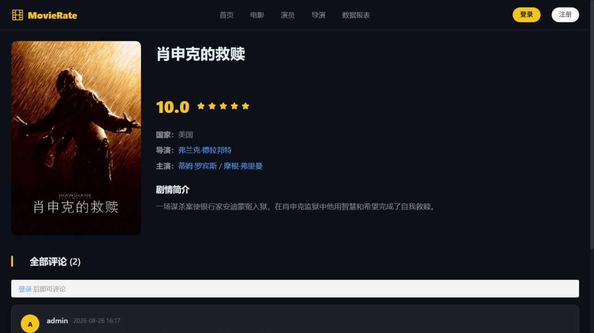
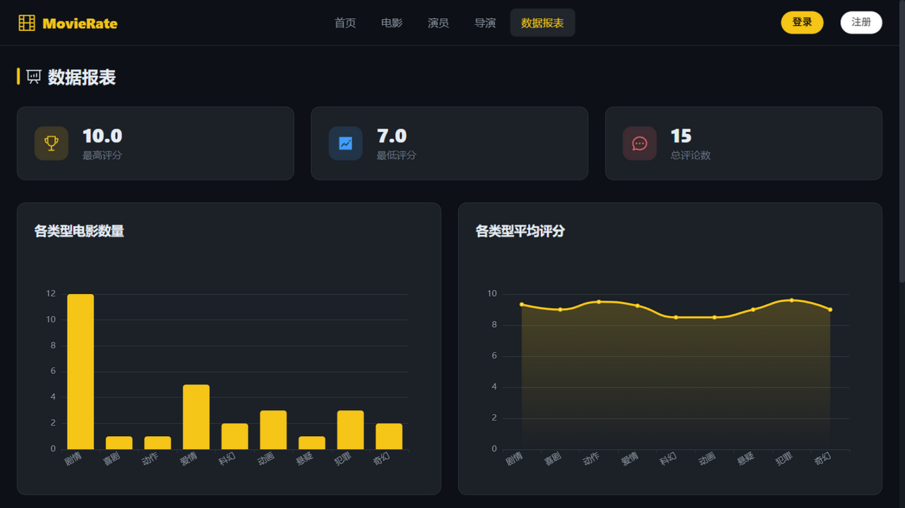
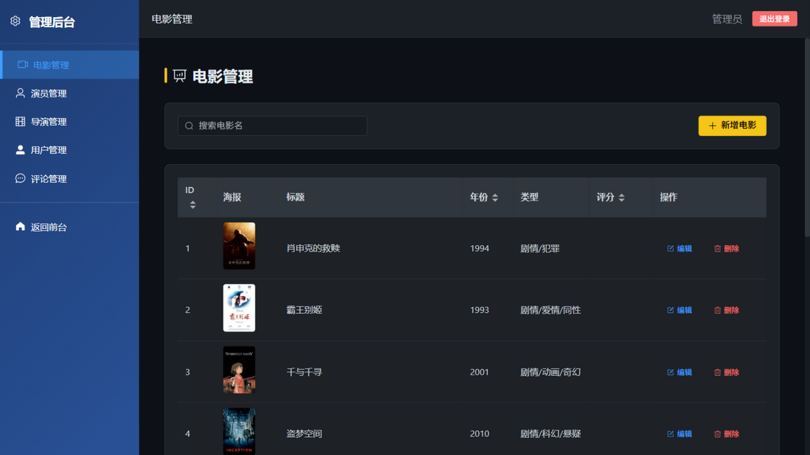
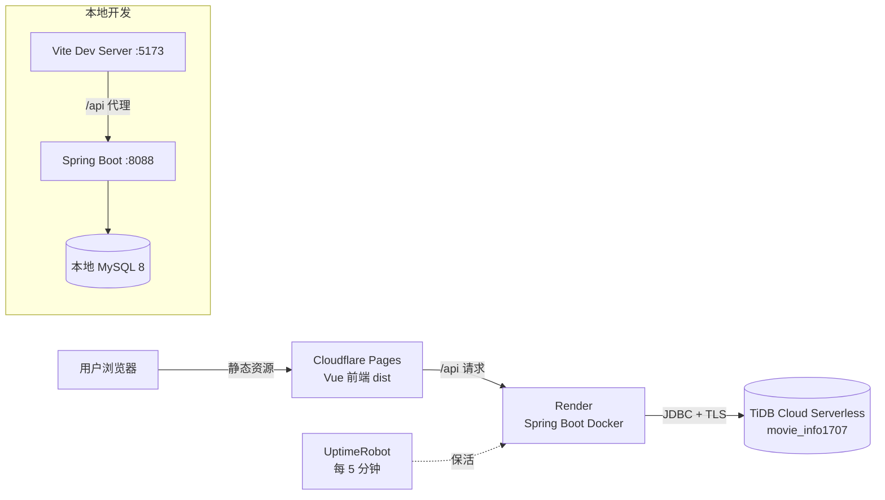

# 电影评分系统 · MovieRating

[](https://github.com/qngfng826/DBProject/actions/workflows/ci.yml)

> 数据库课程设计作品，已打磨为**全栈 + 免费云部署**的个人项目：Spring Boot 单体后端 + Vue 3 前端，覆盖电影浏览、评分、评论、统计报表与完整管理后台。

**在线体验**：<https://movie-rating.pages.dev> —— 前端托管于 Cloudflare Pages，后端为 Render 免费实例（首次访问冷启动约 30 秒）。

`Spring Boot 2.7` · `Vue 3` · `MyBatis-Plus` · `Spring Security + JWT` · `MySQL 8 / TiDB` · `Docker` · `ECharts`

## 界面预览

| 首页 | 电影详情（评分 / 评论） |
| :---: | :---: |
|  |  |

| 统计报表 | 管理后台 · 电影管理 |
| :---: | :---: |
|  |  |

## 功能特性

**用户端**

- 注册 / 登录（JWT 24 小时有效期）
- 电影浏览：分页列表、关键词搜索、详情页
- 电影热度榜：基于数据库视图计算（评分 ≥ 8.0 按热度公式排序取前 10）
- 评分：1–10 分，支持修改 / 删除，自动重算电影均分
- 评论：发表 / 编辑 / 删除（仅本人可操作）
- 我的评分 / 我的评论
- 统计报表：各类型电影的数量、均分、最高 / 最低分，ECharts 可视化

**管理后台**（服务端 `@AuthRequired(admin=true)` 强制校验）

- 电影管理：增删改查，含演员 / 导演关联与角色名编辑
- 演员管理 / 导演管理：增删改查
- 用户管理：搜索、编辑、重置密码、删除
- 评论管理：跨评论内容 / 用户名 / 电影标题的关键字检索，管理员可编辑 / 删除任意评论

## 技术栈

| 层 | 技术 |
| --- | --- |
| 后端 | Spring Boot 2.7.18 · Spring Security · MyBatis-Plus 3.5.3.1 · JWT（auth0 java-jwt 3.18.2）· Lombok（编译 target Java 8，运行 Java 11） |
| 数据库 | MySQL 8（本地） / TiDB Cloud Serverless（生产，MySQL 兼容） |
| 前端 | Vue 3.4 · Vite 5.1 · Element Plus 2.14 · Pinia 2.1 · Vue Router 4.3 · Axios · ECharts 5.5 · dayjs |
| 部署 | Docker 多阶段构建 · Cloudflare Pages · Render · UptimeRobot 保活 |

## 系统架构



生产环境全部使用免费额度，¥0/月。详细部署步骤见 [DEPLOY.md](DEPLOY.md)。

## 数据库设计

- **8 张表**：`user1707` / `movie1707` / `actor1707` / `director1707` / `comment1707` / `rating1707` / `movie_actor1707`（含角色名）/ `movie_director1707`
- **约束**：`rating1707` 的 `(UserID, MovieID)` 唯一（一人一影一评）、`Score` CHECK 1–10、外键约束
- **视图 `v_hot_movies`**：热度公式 `Rating * LOG(CommentCount + 1)`，供首页热度榜
- **索引优化**：7 条索引覆盖标题搜索、评分排序、用户-电影组合查询，见 [DatabaseIndexes.sql](DatabaseIndexes.sql)
- **触发器 / 存储过程**：课程设计原方案在本地 MySQL 使用触发器重算电影均分与 2 个查询存储过程；生产 TiDB 不支持这些特性，已等效迁移为服务层逻辑（`RatingServiceImpl` 重算）与普通 SQL。仓库中的建库脚本为 TiDB 兼容版本，不含触发器定义
- **建库脚本**：[deploy/schema.sql](deploy/schema.sql)（纯结构） / [deploy/init.sql](deploy/init.sql)（结构 + 种子数据） / `deploy/csv/`（TiDB 控制台导入素材）

## 本地快速开始

**前置要求**：JDK 11+（编译 target 1.8）、Node.js 18+、MySQL 8.x

### 1. 初始化数据库

```bash
# 方式一：仅建表结构
mysql -u root -p < deploy/schema.sql

# 方式二：建表 + 示例数据（17 部电影、29 位演员、12 位导演等）
mysql -u root -p < deploy/init.sql
```

### 2. 启动后端

```bash
cd Movie_Rating_Backend
cp application-local.yml.example application-local.yml
# 编辑 application-local.yml：填入本地 MySQL 密码与任意足够长的 jwt.secret
./mvnw spring-boot:run
# 默认端口 http://localhost:8088
```

> **凭据说明**：数据库密码与 JWT 密钥一律不入库。`application-local.yml` 已被 `.gitignore` 忽略；也可改用环境变量 `DB_PASSWORD` / `JWT_SECRET`（优先级更高）。JWT 密钥缺失时后端启动即失败（fail-fast）。

### 3. 启动前端

```bash
cd movie-rating-frontend
npm install
npm run dev
# http://localhost:5173，/api 自动代理到 8088
```

### 4. 使用

- 注册账号即可浏览、评分、评论
- 管理后台权限按用户名判定：`username` 为 `admin` 即管理员（`admin` 为保留用户名，不可自行注册；种子数据中已内置该账号，密码为 BCrypt 哈希，可在本地数据库按需重置）

## 部署

生产架构与完整步骤见 **[DEPLOY.md](DEPLOY.md)**，要点：

| 环境变量（Render） | 说明 |
| --- | --- |
| `DB_URL` / `DB_USERNAME` / `DB_PASSWORD` | TiDB 连接信息（密码只存放于 Render 环境变量） |
| `JWT_SECRET` | **必填**，强随机密钥，缺失时后端启动失败（fail-fast） |

前端 Cloudflare Pages 侧配置 `VITE_API_BASE_URL`（后端地址 + `/api`）与 `NODE_VERSION=20`。推送 `main` 即自动重新部署。

## 安全加固

- 密码 BCrypt 存储，接口响应不返回密码字段（Jackson `WRITE_ONLY`）
- JWT HS256 + 24h 过期；签名密钥仅通过环境变量注入，源码不含任何默认密钥
- 管理端接口服务端强制校验（`@AuthRequired(admin=true)`），不依赖前端隐藏菜单
- 评分 / 评论写操作属主校验：仅本人可修改 / 删除
- CORS 白名单：仅生产域名与本地端口
- 凭据不入库：本地凭据存放于 gitignored 的 `application-local.yml`

## 性能优化

- 7 条索引 + `EXPLAIN` 验证（[DatabaseIndexes.sql](DatabaseIndexes.sql)）
- 列表接口全部分页，避免全表扫描
- 前端 GET 请求 5 分钟内存缓存，写操作自动失效
- 热度榜由数据库视图计算，避免应用层全量遍历

### 压测结果

基于 [docs/jmeter/movie-rating-load-test.jmx](docs/jmeter/movie-rating-load-test.jmx)（JMeter 5.6.3）对 4 个热点读接口做混合负载：电影列表 `/api/movie/list`、电影详情 `/api/movie/13`、热门榜 `/api/movie/hot`、统计报表 `/api/report/genre-summary`。

- **环境**：Windows 本机，后端 `java -jar target/movie-rating-backend-*.jar`（JDK 21，默认堆）+ 本地 MySQL 8；数据集 14 部影片 / 20 条评分 / 15 条评论 / 29 位演员 / 12 位导演（小数据集，结果主要反映应用层与索引路径开销，不代表生产 TiDB 时延）
- **场景**：每档 ramp-up 10s + 采样 60s，4 个接口在同线程内轮转，仅读流量；响应断言 `"code":200`，错误率按断言统计
- **说明**：生产 Render 免费实例（512MB、无访问休眠、冷启动约 30s）不用于基准测试，未纳入本表；JMeter 与被压服务同机运行，属单机上限观测

**分接口明细（50 线程）**

| 接口 | 样本数 | TPS | 平均响应 (ms) | P95 (ms) | P99 (ms) | 错误率 |
|---|---:|---:|---:|---:|---:|---:|
| `/api/movie/list` | 172,020 | 2,871 | 3.5 | 9 | 13 | 0% |
| `/api/movie/13`（详情，多表 JOIN） | 172,012 | 2,872 | 3.8 | 9 | 14 | 0% |
| `/api/movie/hot` | 172,000 | 2,872 | 3.8 | 9 | 14 | 0% |
| `/api/report/genre-summary`（2 条聚合 SQL） | 171,983 | 2,872 | 4.7 | 11 | 15 | 0% |
| **合计** | **688,015** | **11,482** | **3.9** | **10** | **14** | **0%** |

**并发梯度**

| 并发线程 | 总样本数 | TPS | 平均响应 (ms) | P95 (ms) | P99 (ms) | 错误率 |
|---:|---:|---:|---:|---:|---:|---:|
| 20 | 676,827 | 11,300 | 1.6 | 3 | 4 | 0% |
| 50 | 688,015 | 11,482 | 3.9 | 10 | 14 | 0% |
| 100 | 648,531 | 10,833 | 8.4 | 21 | 33 | 0% |

20 → 50 线程吞吐小幅上升后进入平台（约 1.1 万 TPS），100 线程时吞吐不再增长、P95 升至 21ms：本地 JMeter 与被压服务同机竞争 CPU/IO，属于单机环境的上限观测；接口本身在 50 线程内保持 P95 ≤ 11ms、零错误。

## 项目结构

```
DatabaseProject/
├── Movie_Rating_Backend/          # Spring Boot 后端（8 个 Controller / MyBatis-Plus）
│   ├── src/main/java/movie_rating_backend/
│   ├── application-local.yml.example   # 本地凭据模板（真实文件不入库）
│   └── Dockerfile
├── movie-rating-frontend/         # Vue 3 前端（用户端 + 管理后台）
│   └── src/{api,components,router,stores,views}
├── docs/                          # 截图（screenshots/）与 JMeter 压测计划（jmeter/）
├── deploy/                        # 建库脚本与种子数据（schema.sql / init.sql / csv）
├── DatabaseIndexes.sql            # 索引优化脚本
├── DEPLOY.md                      # 免费云部署指南
└── README.md
```

## 注意事项

- **免费实例冷启动**：Render 免费额度无访问约 15 分钟后休眠，冷启动约 30 秒；生产环境用 UptimeRobot 每 5 分钟保活
- **TiDB 限制**：不支持触发器 / 存储过程，生产相关逻辑已在代码层等效实现
- **凭据安全**：请勿将任何密码 / 密钥提交到仓库；本地使用 `application-local.yml`

## TODO 路线图

- [x] 单元 / 集成测试（鉴权链 + 核心 CRUD，24 例）
- [x] GitHub Actions CI（后端构建 + 前端构建）
- [x] JMeter 压测数据回填（TPS / P95 / 错误率）
- [ ] Redis 热点缓存（可选）

## 文档

- [DEPLOY.md](DEPLOY.md) —— 免费云部署指南（TiDB + Render + Cloudflare Pages）
- [DatabaseIndexes.sql](DatabaseIndexes.sql) —— 索引优化脚本
- [deploy/](deploy/) —— 数据库备份与导入材料

## 声明

本项目为数据库课程设计作品，仅供学习交流使用。